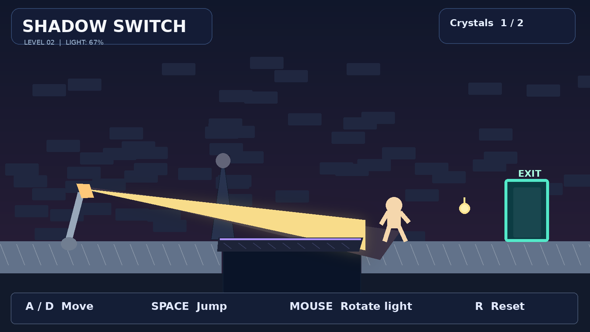

# Shadow Switch – מתג הצללים

> **סובבו את האור, בנו דרך מתוך החושך.**

**סוג:** משחק פאזל־פלטפורמה דו־ממדי לשחקן יחיד | **פלטפורמה מיועדת:** Windows | **מנוע מתוכנן:** Unity / C#

במשחק זה מכוונים פנסים ומשנים את הצל שמטילים חפצים, כך שהצל עצמו הופך לגשר מוצק מעל מכשולים. על השחקן לחצות חדרים, לשמור על אנרגיית האור ולהגיע ליציאה באמצעות פתרון חידות מרחביות ותזמון נכון.

**מסמך הרכיבים הרשמיים:** [formal-elements.md](formal-elements.md) – שמונת הרכיבים, דוגמאות, ציורי מסך, סקירת מתחרים והבדלים מוצעים.

**חברי הצוות:** אחמד בשיר

**סטטוס:** רעיון ומסמך עיצוב במסגרת מטלת פתיחה בקורס פיתוח משחקי מחשב. עדיין אין מימוש משחק פעיל; התמונות הן המחשות קונספט.
