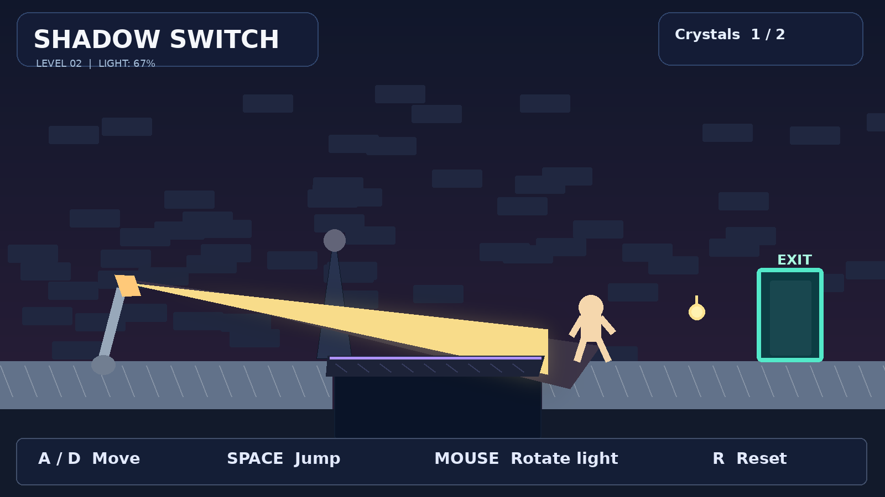
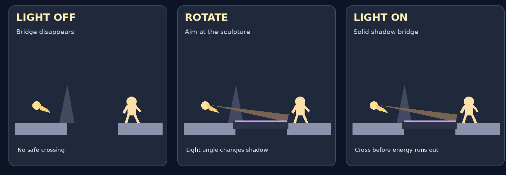

# Shadow Switch – מתג הצללים

**tagline: סובבו את האור, בנו דרך מתוך החושך.**

## מהות המשחק

Shadow Switch הוא משחק פאזל־פלטפורמה דו־ממדי שבו השחקן נע בחדרים חשוכים ומנסה להגיע ליציאה. במקום להשתמש בצל כגורם מאיים, השחקן יכול **להפוך צללים מסוימים לגשרים ולמשטחים מוצקים** באמצעות כיוון פנסים והזזת מקורות אור. שינוי מיקום האור משנה את צורת הצל ולכן גם את המסלול האפשרי; לפעמים צריך להפעיל אור לזמן קצר, לעבור עליו ולכבות אותו כדי להפעיל מנגנון נוסף. כל שלב מחייב להבין את הקשר בין מקור האור, עצם שמטיל צל, משטח ההקרנה והיעד.

**פלטפורמה:** מחשב אישי (Windows; יעד משני אפשרי: macOS). **מנוע מתוכנן:** Unity 2D, בשפת C#. **מצב הפרויקט:** מסמך רעיון בלבד; ציורי המסך הם המחשות, ולא צילום מתוך משחק שפותח.

*ציור־מסך 1: פנס מכוון לפסל שמטיל צל מוצק מעל בור. המד מציג אנרגיית אור, ומעליו מספר גבישי אנרגיה זמינים.*

---

## רכיבים רשמיים

### 1. שחקנים

- **קהל יעד:** בני 12 ומעלה, חובבי חידות סביבתיות, משחקי פלטפורמה, משחקי חשיבה ופתרונות יצירתיים. בשלב הראשון לא נדרש ידע מוקדם בפיזיקה או בגאומטריה.
- **מספר שחקנים:** שחקן אחד במחשב אחד.
- **אינטראקציה:** אין שחקנים יריבים או שיתוף פעולה אנושי. האינטראקציה היא בין השחקן, הפנסים, החפצים והצללים בעולם המשחק. בהמשך אפשר להוסיף שיתוף של פתרונות בין שחקנים, אך זה אינו חלק מהגרסה הראשונה.

### 2. יעדים

- **יעד ראשי:** להגיע אל דלת היציאה מבלי ליפול לבורות או להיתקע ללא משאבי אור.
- **יעדי ביניים:** למצוא מקור אור, לכוון אותו אל עצם מסומן, ליצור משטח צל יציב מעל מכשול, לעבור בבטחה ולהפעיל מתגים הדרושים לפתיחת היציאה.
- **יעדי רשות:** לאסוף גביש אנרגיה נסתר או לסיים את החדר עם יתרת אנרגיה גבוהה יותר.
- **מסירת יעד:** דלת היציאה מודגשת בצבע טורקיז, נקודות עיגון לפנסים מסומנות בזהב, ועל שלב ההיכרות מופיע חיווי קצר: "סובבו את האור כדי ליצור מעבר". כאשר הגשר הופך למוצק הוא מקבל קו מתאר סגול והודעת `Bridge active`.

### 3. תהליכים

**תהליך התחלה – שלושים השניות הראשונות:**

| זמן | מי עושה מה, איפה ואיך? | מה קורה במשחק? |
|---|---|---|
| 0–5 שניות | הדמות מתחילה משמאל בחדר קטן. השחקן לומד ללכת עם `A/D` ולקפוץ עם `Space`. | ממול נמצא בור שהקפיצה הרגילה אינה מספיקה כדי לעבור אותו; היעד נראה מעברו השני. |
| 5–12 שניות | השחקן מתקרב אל פנס על מתקן ומסובב אותו באמצעות גרירה בעכבר. | אלומת אור נעה על פני חפץ בעל צורה מיוחדת; מופיע צל על אזור הבור. |
| 12–20 שניות | כשהאלומה מגיעה לזווית הנכונה, נוצר גשר צל בעל קו מתאר סגול. | צל שהיה קודם חסר שימוש הופך למשטח שאפשר לעמוד עליו. |
| 20–30 שניות | השחקן הולך על הגשר אל דלת היציאה. | מופיע מסך ניצחון קצר; בשלב הבא מתווסף מד אנרגיה וצריך לחצות בטרם הפנס כבה. |

**תהליך הליבה:**

1. **סורקים את החדר:** מזהים פנסים, חפצים מטילי צל, בורות, משטחי הצל ויציאה.
2. **בוחרים תצורת תאורה:** מתקרבים לפנס מסומן, מסובבים את כיוונו בגרירת העכבר ומפעילים או מכבים אותו באמצעות `E`.
3. **מייצרים צל שימושי:** כאשר האלומה פוגעת בעצם ובמשטח הקרנה מתאים, המערכת מסמנת גשר מוצק. בגרסה המתוכננת, רק אזורי צל מסומנים מראש יכולים להפוך למשטחים נושאי משקל, ולא כל הצללים בסביבה.
4. **חוצים או פותרים חידה:** זזים עם `A/D`, קופצים עם `Space`, ונעזרים בגשר כדי להגיע למתג או לצד השני.
5. **מנהלים משאבים:** בוחרים מתי להפעיל את הפנס כדי לא לבזבז אנרגיה. אם זו הזווית הלא נכונה, משנים אותה; `R` מאפס את החדר.

**תהליך סיום:** לאחר שהצללים יוצרים מסלול שמיש והמתגים הדרושים פועלים, הדמות מגיעה ליציאה. מעבר בדלת מציג `Level complete`, מספר הפעלות הפנס וכמות האנרגיה שנותרה. נפילה לבור או היתקעות בלתי פתירה גורמת לאיפוס החדר, כאשר המשאבים חוזרים למצב התחלתי.

**איך לומדים?** בשלב 1 אין מגבלת אנרגיה, כך שאפשר להתנסות ללא לחץ; מופיע רמז קצר ליד הפנס. בשלב 2 מתווסף מד אנרגיה ובשלב 3 צריך להחליף בין שתי זוויות תאורה. הדגשת גשר פעיל בצבע סגול היא משוב חוזר וברור.

*ציור־מסך 2: מעבר ממצב ללא גשר ליצירת גשר צל שמאפשר לחצות את הבור.*

### 4. חוקים

- התנועה מתבצעת בעולם דו־ממדי עם כוח משיכה וקפיצה מוגבלת. אי אפשר לעבור דרך קיר או לדרוך על בור ללא משטח.
- **רק צל שמוטל מאובייקט ייעודי אל אזור הקרנה מסומן** יכול להפוך לגשר מוצק; צל רגיל על הרקע הוא קישוט בלבד. בכך החוקים צפויים וברורים, והמימוש אפשרי יחסית במסגרת פרויקט סטודנטיאלי.
- כדי ליצור גשר חייבים: (1) להפעיל פנס, (2) לסובב אותו לזווית הנכונה, ו־(3) ליצור רצף צל מעל אזור המכשול.
- כאשר הפנס נכבה או מקור האור זז, הגשר מתבטל. אם הדמות עומדת על הגשר בזמן שהוא מתבטל, היא נופלת.
- החל מהשלב השני, פנס פועל צורך אנרגיה באופן קבוע. גביש אנרגיה חד־פעמי מוסיף אנרגיה למד, עד למקסימום מוגדר.
- המערכת בודקת את זווית התאורה, מיקום העצם וגבולות אזור הצל. כאשר התנאים מתקיימים, המשטח משנה את מצב ההתנגשות שלו ל"מוצק"; אחרת הוא אינו פעיל.
- `R` משחזר את מיקום הדמות, הפנסים, האנרגיה והחפצים למצב ההתחלתי של החדר.

**לימוד החוקים:** בתחילה פנס אחד וגשר אחד. רק לאחר הצלחה יופיעו פנסים נוספים, מגבלת אנרגיה ומכשולים שמצריכים שינוי תאורה תוך כדי תנועה. ההבדל בין משטח פעיל ללא פעיל מודגש בקו מתאר ובעזרת צליל קצר.

### 5. משאבים

| משאב | מה התועלת? | איך משיגים אותו? | כיצד הוא נדיר? | איך מציגים? |
|---|---|---|---|---|
| אנרגיית אור | מאפשרת להדליק פנס וליצור גשר מוצק | מתחילים כל שלב עם מד אנרגיה חלקי; ניתן לטעון באמצעות גביש | האנרגיה יורדת כל עוד הפנס פועל; אין טעינה אוטומטית חופשית | מד `Light: 67%` בחלק העליון |
| גבישי אנרגיה | ממלאים חלק מן המד ומאפשרים ניסיון נוסף | אוספים גביש במפה על ידי מגע | מספר הגבישים קטן וקבוע בכל שלב (למשל 1–2) | סמל גביש ומונה `Crystals: 1/2` |
| זמן פעולה של הגשר | מאפשר לחצות כאשר האור פעיל | באמצעות מיקום נכון של הפנס ושימור אנרגיה | תלוי באנרגיה שנותרה; אין גשר קבוע בחדר | הבהוב כשהאנרגיה כמעט נגמרת |
| מקורות אור זמינים | מאפשרים לייצר צל מזוויות שונות | מתגלים בהתקדמות בשלבים | הפנסים מחוברים לנקודות קבועות ומספרם מוגבל | פנסים מודגשים בצבע זהב |

### 6. עימותים

- **השחקן מול המערכת:** בורות עמוקים, פנסים שמקרינים מזווית מוגבלת, גשרים זמניים, דלתות נעולות וחוסר באנרגיית אור.
- **השחקן מול שחקנים אחרים:** לא קיים במשחק הבסיסי.
- **השחקן מול עצמו:** האם להפעיל את האור עכשיו ולנצל את המומנטום, או לחסוך אנרגיה עד שמגיעים לזווית נכונה? האם להשתמש בגביש בנתיב המהיר או לשמור אותו לאזור שטרם נחקר?

**דוגמה לעימות מרכזי:** שתי תהומות מופרדות על ידי רצפה בטוחה, ולשחקן יש די אנרגיה להארה של אחת מהן בלבד. עליו לכוון פנס בזווית מדויקת, לחצות במהירות, לאסוף גביש שמונח בין התהומות ורק אז להשתמש בפנס הבא.

### 7. גבולות

- **סוג עולם:** סגור, סדרת חדרי פאזל קצרים. אין עולם פתוח.
- **גאומטריה:** דו־ממדית ושטוחה; הקצוות אינם מחוברים זה לזה ואין מעבר דרך גבולות המפה.
- **הצגת גבולות:** קירות אטומים וקווי קצה ברורים, תהומות כהות, משטחים נגישים מוארים, דלת יציאה בעלת מסגרת בולטת.
- **עקרונות תכנון המפה:**
  - **משמעות:** בכל חדר נלמד קשר אחד בין מקור אור, עצם וצל; כל אובייקט שימושי מסומן ואינו רק קישוט.
  - **ניידות:** פלטפורמות רחבות, מרחקי קפיצה סבירים ונקודות פנס נגישות במרחק הליכה.
  - **התמצאות:** עיצוב קבוע – פנסים בצהוב, גשרים מוצקים בסגול, יציאה בטורקיז; היעד נראה מהכניסה.
  - **עניין:** חדרי מעבדה משתנים, חפצים בצורות חדשות, פנסים מקובעים וניידים, והצורך להחליף זוויות לאורך הדרך.
  - **הכוונה:** אלומות אור ומשטחים מסומנים מובילים את עיני השחקן מחפץ לפתרון; המפה מראה חזותית את השינוי המתחולל כשמסובבים פנס.

**מפת שלב לדוגמה:** התחלה על רצפה משמאל → פנס על עמוד → חפץ מטיל צל → בור וחלק קרקע ששימש ליצירת גשר → גביש אנרגיה → דלת יציאה מימין.

### 8. תוצאות

- **תוצאות אפשריות לשלב:** (1) ניצחון – הדמות מגיעה לדלת; (2) כישלון זמני – נפילה או התכלות האנרגיה ללא אפשרות להמשיך, שבעקבותיהם ניתן לאפס. אפשר להוסיף מדליות רשות לפי חיסכון באנרגיה.
- **תוצאות למשחק כולו:** השלמת כל החדרים היא ניצחון. אין גרסאות של סיום עלילתי בגרסת הבסיס.
- **מזל או כישרון:** הפתרונות מתבססים כמעט לחלוטין על ניסוי, תכנון מרחבי, הבנת זוויות ותזמון. אין הגרלה אקראית של ציוד.
- **סכום אפס / שיתופי / מורכב:** משחק לשחקן יחיד שאינו סכום־אפס מול יריב. היחסים העיקריים הם בין השחקן למערכת החידות, לא מול שחקן אחר.

---

## סקירת משחקים קיימים

**שיטת החיפוש:** חיפוש אינטרנטי באתרי משחקים ובחנויות דיגיטליות. ביטויי החיפוש: `light shadow puzzle platformer game`, `Closure game light makes platforms solid`, `Contrast game shadows 2D 3D`, `Shady Part of Me light and shadow puzzle`, `shadow bridge puzzle game`. **לא בוצע חיפוש ידני בפייסבוק או ב־Google Play, ולכן לא נטען שחיפשנו שם.**

### 1. Closure (2012)

- **קישור:** [Closure – Steam](https://store.steampowered.com/app/72000/Closure/)
- **דמיון:** משחק פאזל שבו האור משנה אילו משטחים קיימים או נגישים; תפעול התאורה הוא חלק מרכזי מהפתרון.
- **מה יהיה שונה אצלנו:** במקום שבו האור יוצר/חושף את העולם, Shadow Switch משתמש דווקא ב**צל המוטל** מאובייקטים מסומנים כדי ליצור גשר קשיח, ומוסיף ניהול אנרגיה מוגבלת ותזמון. מנגנון האור עצמו אינו חידוש מוחלט.

*מקור צילום: [Steam – Closure](https://store.steampowered.com/app/72000/Closure/).*

### 2. Contrast (2013)

- **קישור:** [Contrast – Steam](https://store.steampowered.com/app/224460/Contrast/)
- **דמיון:** משחק פאזל־פלטפורמה שבו אור, צל ושינוי המיקום שלהם מאפשרים פתרון חידות ומעבר בין מקומות.
- **מה יהיה שונה אצלנו:** Contrast עוסק גם במעבר בין עולם תלת־ממדי לדמות־צל דו־ממדית; אצלנו המרחב כולו נשאר דו־ממדי, והמשימה היא **להשתמש בצל של חפץ כמשטח בנייה זמני** באמצעות כיוון פנס ומד אנרגיה.

*מקור צילום: [MobyGames – Contrast](https://www.mobygames.com/game/63205/contrast/screenshots/windows/804376/).*

### 3. Shady Part of Me (2020)

- **קישור:** [Shady Part of Me – Steam](https://store.steampowered.com/app/1116580/Shady_Part_of_Me/)
- **דמיון:** פתרון חידות באמצעות קשר בין אור וצל ובין שתי צורות קיום של הדמות.
- **מה יהיה שונה אצלנו:** המשחק שלנו אינו מבוסס על החלפה בין ילדה לצל שלה או על נרטיב רגשי. השחקן מפעיל פנסים כדי **לתכנן מסלול פיזי בחדר**, תוך החלטה מתי להפעיל גשר ומתי לחסוך אנרגיה.

*מקור צילום: [Maxi-Geek – Shady Part of Me](https://www.maxi-geek.com/con/shady-part-of-me-review).*

**מדוע שחקנים עשויים להעדיף את Shadow Switch?** הגישה שלנו מכוונת לחידות קצרות שבהן שינוי קטן בזווית הפנס יוצר תוצאה חזותית מידית, וההתקדמות קשורה באופן ברור ליצירת גשר בעזרת צל. המשחק אינו מחייב שליטה בתלת־ממד, והצבעים מסמנים מה ניתן להפעיל. זו **השערת תכנון** שתיבדק בהמשך מול שחקנים, ולא נתון מחקרי על השוק.

**הרכיבים הרשמיים שמדגישים את המקוריות:** בעיקר **חוקים** (רק צלים ייעודיים הופכים למשטחים מוצקים), **תהליכים** (כיוון פנס → יצירת גשר → חצייה בזמן מוגבל), **משאבים** (אנרגיה וגבישים בודדים), ו**גבולות** (חידות קצרות בחדרים דו־ממדיים).

**בדיקת התאמה לקהל היעד:** מומלץ להציג אב־טיפוס ל־3–5 שחקנים בני 12+, ולבדוק אם הם מבינים בלי הסבר מהו צל שמיש, מה קורה כאשר הפנס כבה והאם מחסור באנרגיה גורם להם לחשוב או רק מתסכל אותם. אלה **מבחנים מוצעים**, לא ניסויים שכבר נערכו.
